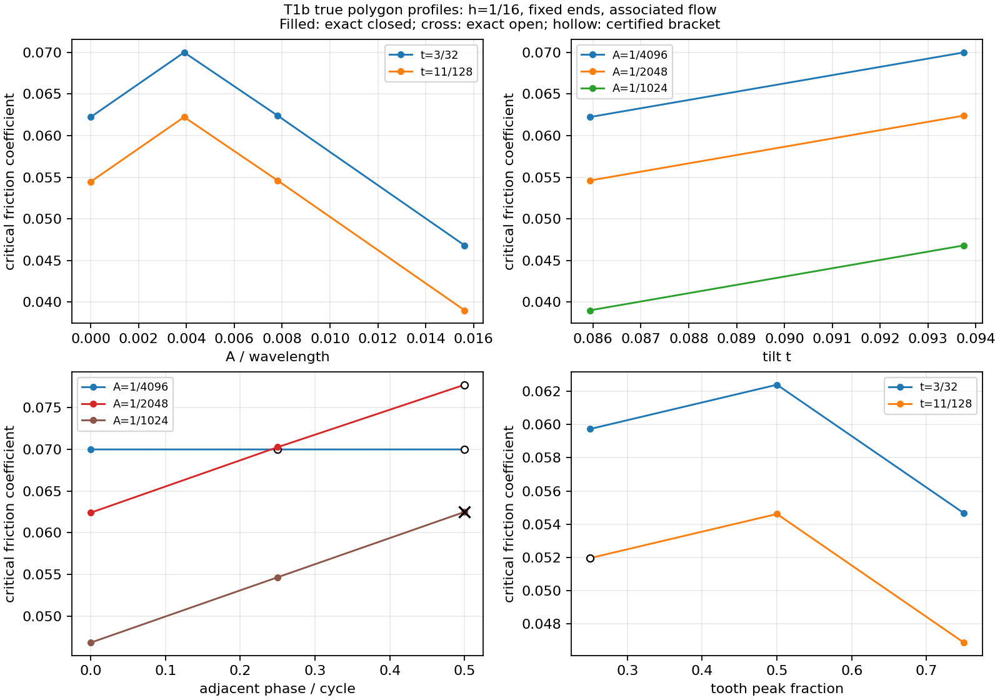

# WO-T1b：TIA 二维制造公差困住与非退化形貌

**一句话结论：给定的有理多边形例子已能用独立核验的路径判断“还能否逃出”，并找到真正随齿形变化的摩擦阈值；这些结果只属于平移几何和 profile1 理想模型，不是转动锁定或实际材料强度证明。**

**交付状态为 PARTIAL：收尾全档两项静态门失败，已仅改写测试辅助函数并作定向复核，但按“一次收尾全档”的成本合同没有追加完整四分片复验；不能把修复前快档绿或修复后定向绿写成最终全绿。**

本报告由 Codex 执行，供 Claude 交接审阅。开工基线 `7f9510502ba265e53b5be8de4be22308dfe65f9a`；工作树 `D:/eab-wt/cx-e2`。初次检查干净，未执行任何 Git 写命令。原设计 SHA-256 为 `6d174ecc4f1326d5bac21c56c8d333485fb50bbaef3a12150e94eaff14cb4dac`，设计及 tia2d-2 schema 均未修改。成果由**未提交工作字节**生成，基线提交不是这些新成果的来源提交；最终数据保存实际源码前后 SHA256。

## 1. 口径、范围与交付导航

- 力学沿用 profile1：刚体、小变形、无限抗压、无黏聚、恒定 μ、关联流动。UNBOUNDED 不是锁定；一阶可动性不是有限运动。
- P0 固定其余块，仅询问一个块的全局平移空间；G5 力控端板在这个几何询问中也固定。腐蚀政策只决定墙/端板是否缩小，其他普通邻块始终腐蚀。
- 单位任意但自洽，所有几何、δ、证书坐标均为有理数。图上小数仅供显示；精确输入不由图或舍入数还原。
- 实测运行时 Python 3.12.10；数值代码纯标准库，只有设计曲线使用 matplotlib。
- 仅写本工作树及获准的 `D:/eab-evidence/reports/codex/T1b_evidence/`；不写姊妹仓库，不新增静态构造准入，不改既有数学合同。
- 没有生成新的 C++ 正式批次。新增诊断数据**不冒用 tia2d-2 schema**，新公共字段均列在第8节供 Claude 决定。

关键成果：[P0小汇总](T1b_evidence/p0_final_summary.json)、[P0完整输入及证书](file:///D:/eab-evidence/reports/codex/T1b_evidence/p0_final.json)、[P1小汇总](T1b_evidence/p1_summary.json)、[P1完整证书](file:///D:/eab-evidence/reports/codex/T1b_evidence/p1_final_20261022/)、[设计曲线](T1b_evidence/p1_figures/p1_design_curves.png)、[交付清单](T1b_evidence/artifacts.md)。逐文件完整性与外部映射见 [EVIDENCE_ARCHIVE](../EVIDENCE_ARCHIVE.md)。

## 2. A：精确腐蚀、自由空间与独立证书

### 2.1 公差模型与拒收

对简单无洞实心多边形 P，使用闭腐蚀 `Pδ=P⊖δK={x:x+δK⊆P}`。K 分别为 `[-1,1]²` 和顶点 `(±1,±5/12)、(±5/12,±1)` 的有理八边形；后者只是圆形结构元的多边形近似。δ 不经浮点舍入。

`erosion.py` 对凸环精确内移支持半平面；凹环构造边/顶点接触排列，分割所有交点，以先于最近事件的有理左右探针判面，再追踪边界环。它**不是凹环所有原边半平面交**。包含判据还检查结构元严格内部的均值和输入边不得进入其开内部；仅查顶点会在凹槽内产生假包含。

多个环、零面积、孤立点/细线残片、非流形边界均拒收，保留明确理由，不把拒收冒充可逃逸。具名主门为 `test_tia2d_t1b_erosion.py`：独立矩形网格覆盖 oracle、L形与八边形反角闭式、细颈断裂/退化、凹槽反例及确切变换。详见[腐蚀与闭式推导](T1b_evidence/erosion_notes.md)。

### 2.2 判定定义与生产搜索

`Oδ=∪j O(Aiδ,Ajδ)` 为**开贯入集**，`Fδ=R²\Oδ` 保留合法接触边/点。原位0若本来贯入，则没有本单所需自由分量，返回 UNPROVED 及理由。

公差把原接触变成间隙后，这里不再套用原文§3.10的接触锁定措辞；“自由分量是否有界”是本单新增的问题和定义，不能倒写为石根华原文已给出的制造公差定理。

- TRAPPED_TRANSLATION：0所在自由分量有界，且已经通过严格绕数屏障核验。
- ESCAPABLE_TRANSLATION：已经通过有理逃逸折线和末端无限射线核验。
- UNPROVED：输入腐蚀拒收、资源限额或未取得可核验证书；不能读成未困住。

生产 `translation_space.py` 使用原有 `GlobalEntrance2` 的全局开凸片并集。严格相交凸片的中心/交集内点图提出闭曲线；图的基本圈用整数绕数筛选。自由路径先试直线，再用完整边交点排列上的可见图搜索，包括零宽接触缝。**没有把障碍并集换成凸包**。搜索的路径选择/三角剖分序不是公共语义合同。

默认最多512个障碍凸片、2000个排列/可见图顶点；资源限额返回 UNPROVED。这些是搜索资源限额，不是数值阈值；目前限额检查不能为之前的复杂分片构造给出硬墙钟保证。未宣称任意大输入都可在固定时间内完成。

### 2.3 独立核验器的原语与两类证书

`translation_certificates.py` **只导入标准库**，不调用生产 E/O、GlobalEntrance2、生产三角剖分，甚至没有调用允许共用的 `polygons_overlap_exact`。它独立检查简单环并耳切；凸输入保留完整凸片；依据凸片两边族法向作精确 SAT。

1. **逃逸**：从0开始的有理折线，每段闭区间参数 `t∈[0,1]` 与严格投影重叠不等式相交。存在满足所有严格不等式的参数就拒绝；不是只查端点。末端长度平方严格大于原始顶点差 `b−a` 包围盒的对角线平方，还须在该盒外，并返回一条明确的向外坐标轴射线。因此证书确实通向无穷，而非只走了一段很长的路。
2. **困住**：显式首尾重合、关于0绕数非零的有理闭折线。每条线段的两端须满足**同一独立凸片对**全部严格 SAT 不等式，由仿射性证明整段位于该开贯入片内。跨片需要生产显式细分。原位自由；任意通向无穷的自由路径都会改变绕数，必穿越屏障，矛盾。

独立性由 `test_verifier_imports_no_production_geometry` 守护；语义门为 `test_enclosure_has_strict_witnesses`、`test_escape_rejects_a_segment_with_only_free_endpoints`、`test_escape_checks_origin_length_and_explicit_infinite_ray`。完整解释及字段见[核验器说明](T1b_evidence/certificates_notes.md)。

### 2.4 晃动范围：有证书的上下界，不冒称精确分量

返回面积区间与**直径平方区间**。若平方界为 `[a,b]`，直径界严格解释为 `[√a,√b]`，不把平方数当长度。下界来自原点附近半径 r 的整个闭正方形：核验器以 SAT 检查填充方形的所有平移，而非只查四边；它连通到0，故面积至少 `4r²`、直径平方至少 `8r²`。上界来自绕数屏障的包围矩形，边长 dx、dy 给出 `area≤dx·dy`、`diam²≤dx²+dy²`。

这些界可能很宽，尤其δ=0时下界可为0。`test_wobble_checks_the_filled_square_not_only_its_boundary` 防止漏掉方形内部的障碍。手造方形腔的真实分量为 `[-3,3]²`，面积36、直径平方72，已由 `test_large_clearance_remains_trapped_with_certified_wobble_bounds` 夹住。每个 TRAPPED 样点的界及独立核验都在 P0 JSON。

例：稳健燕尾 `wk=5,wn=1,h=4`、方形K、墙也腐蚀、δ=3/8，认证面积 `[9/4,425/8]`、直径平方 `[9/2,1781/16]`。这只报范围，不报不存在的精确面积。

### 2.5 临界公差与单调二分

腐蚀随δ增加使每个实体缩小，因此 Oδ 递减、Fδ 递增；若0已有逃逸路径，后续非退化域内不会重新困住。`critical_tolerance` 只在已认证 T/E 两端之间作二进有理二分，每个返回端点保留完整证书；中途拒收/未证就明确中止，不猜开闭。

独立复核还发现并修复了一个输入消费错误：多次询问若重复消费障碍生成器，第二次可能看到空障碍而签发假逃逸；入口现冻结 moving、obstacles、K。具名回归覆盖三类迭代器。此复核是本次内部开发 QA，**不是 Claude 安排的独立对抗验收**。

## 3. A：燕尾榫、凸耳和逐内块结果

### 3.1 燕尾榫闭式与3×3参数网格

榫头底宽 wk、榫颈上宽 wn、高 h；两侧墙和下墙有限厚，上方开口。令 `m=(wk−wn)/(2h)`、`H=supportK(1,m)`、`c=m+H`，e=1表示边界也腐蚀，e=0表示保留。

移动块最大水平宽度为 `wk−2cδ`；边界上端喉口宽度为 `wn+2ecδ`。从下向上通过须使最宽截面越过喉口，因此瓶颈事件是

**`δ*=(wk−wn)/(2c(1+e))`。**

也可把沿上移 v 的两侧不贯入条件写成 `mv≤(1+e)δH`；移动底部到达墙顶时 `v=h−(1+e)δ`，消去v得到相同事件。等号时整条向上路径允许接触但不贯入，因此δ*本身可逃逸，TRAPPED上端开。

这里限定实际扫描尺寸 `h=2,wall=2`。e=1时事件先于下方接缝可容纳块高（该域内上下水平支撑仍活跃，δ*<h/4）；e=0时下方通道零高度而移动块仍有正面积。个别较大腐蚀量会把移动梯形变三角形，不能无条件使用 h−2δ 作为其实际高度。有限厚侧部仍保留屏障；没有将上述式子推广为任意墙宽/任意形貌的判定器。

方形 `H=1+m`；本扫描0<m<1，八边形 `H=1+5m/12`。每组查δ=0、δ*−ε、δ*、δ*+ε，ε=min(1/1024,δ*/4)，均为 T/T/E/E；另从二进有理端点二分10次并保存两端独立证书。

| wk | wn | 方形，墙保留 | 方形，墙腐蚀 | 八边形，墙保留 | 八边形，墙腐蚀 |
|---:|---:|---:|---:|---:|---:|
| 5/2 | 1 | 3/7 | 3/14 | 24/49 | 12/49 |
| 5/2 | 3/2 | 1/3 | 1/6 | 24/65 | 12/65 |
| 5/2 | 2 | 1/5 | 1/10 | 24/113 | 12/113 |
| 3 | 1 | 1/2 | 1/4 | 24/41 | 12/41 |
| 3 | 3/2 | 3/7 | 3/14 | 24/49 | 12/49 |
| 3 | 2 | 1/3 | 1/6 | 24/65 | 12/65 |
| 7/2 | 1 | 5/9 | 5/18 | 120/181 | 60/181 |
| 7/2 | 3/2 | 1/2 | 1/4 | 24/41 | 12/41 |
| 7/2 | 2 | 3/7 | 3/14 | 24/49 | 12/49 |

表内均为精确δ*，均不取到。

36个政策/参数组合全部通过具名闭式门 `test_tia2d_t1b_tolerance.py`；这不是36个不同物理原型，也不是全参数证明。

### 3.2 拼图式凸耳：只对8条实际弦成立

`tolerance_knob(segments=4,wk=2,wn=1,h=2)` 用有理半角采样并线性截颈：每半圆采样4段，实际鼓包共8弦，再接直颈。结论只对该多边形成立，不对圆或加密极限成立。

最宽点两邻弦为 `x=1−|y−1|/2`，令 `H=supportK(1,1/2)`；腐蚀后最大半宽 `1−Hδ`。保留墙的喉口半宽1/2，故δ*=1/(2H)。墙也腐蚀时，当前活跃上肩 `x=3/2−y/2` 和墙顶 `y=2−δ` 给出喉口半宽 `1/2+(H+1/2)δ`，故δ*=1/(4H+1)。对应事件处满足该弦段分支，底部缝尚不能通过整个块。

| K | 边界政策 | 精确δ*（不取到） | 独立二进有理括号 |
|---|---|---:|---|
| 方形 | 墙保留 | 1/3 | [1365/4096,5467/16384] |
| 方形 | 墙腐蚀 | 1/7 | [1169/8192,2345/16384] |
| 八边形 | 墙保留 | 12/29 | [847/2048,6783/16384] |
| 八边形 | 墙腐蚀 | 6/35 | [2807/16384,1407/8192] |

四项另核δ*±1/16384及δ*，均 T/E/E，因此均不取到。括号本身的 attained=null 与另行证明的 exact_threshold/attained=false 分开存放，不从窄括号猜开闭。

### 3.3 TIA-G1与TIA-G5：空困住集不填“临界值0”

G1 取 Koureas 布置 t=3/32、h=1；G5 取 n=3/5/7、h=1。四种K/边界政策对下列每一内块在δ=0和δ=1/64都得到已独立核验的逃逸路径：

| 布置 | 逐块列举（每一项均 E/E） | δ* |
|---|---|---|
| G1 | block_2、block_3、block_4 | null：δ=0已可逃逸 |
| G5，n=3 | block_1、block_2、block_3 | 同上 |
| G5，n=5 | block_1、block_2、block_3、block_4、block_5 | 同上 |
| G5，n=7 | block_1、block_2、block_3、block_4、block_5、block_6、block_7 | 同上 |

共18内块×4政策=72条目、144次状态查询。部分G1路径需绕行，不能用一条局部入口射线替代；数据明确保存 `direct_free_path/arrangement_free_path`。困住集为空时输出 `empty_trapped_set_already_escapable_at_zero`，不把空集上确界写成0；不借用 LP 的 UNBOUNDED 作判断。

### 3.4 两个具名标准例

- **小正公差敏感**：wk=1025/1024、wn=1、h=2，δ=0困住，δ=1/1024时四政策均逃逸；方形、墙腐蚀的δ*=1/4098。阈值可随头颈差任意小，但不是0。
- **较大公差仍困住**：wk=5、wn=1、h=4、wall=3，δ=3/8时四政策均严格困住。“较大”仅指达到颈宽37.5%，不是任意大δ；退化会拒收。

原“任意正公差立即逃逸”的不可能性订正见第7节；具名门和所有8组政策结果见 P0 小汇总。

## 4. B：非退化形貌族、曲线与导数

### 4.1 定义与适用边界

采用薄块 h=1/16、水平名义间距ℓ=2，公开改变细长比以避免厚块直接落入零阈值退化域。边界仍是两端 FIXED_BODY，中块在x=0受竖向单位活载，无恒载；参考点与实际LP锚点为 `(5/8,−3/8)`。

四个内部界面 `xk(y)=−5+2k+σk[t(y−h/2)+A fk(y)]`，σ=(-1,-1,1,1)。

- 锯齿：`u=(y/λ+(k−1)φ) mod 1`，`f=u/η`（u≤η）或`(1−u)/(1−η)`。η=1/4、1/2、3/4给非对称/对称两坡度。
- t∈{3/32,11/128}；A∈{1/4096,1/2048,1/1024}另有0控制。
- λ=h/n，n∈{1,2,4}；h固定时实际改变λ，波长不再恒等块高。h/λ仍限制为规定整数周期，并未实现任意截断周期。
- 相邻界面相位增量φ∈{0,1/4,1/2}。
- kinked：`f=max(0,(y/h−η)/(1−η))`，仅两直段，不声称光滑。

所有配合面共享同一组有理顶点，完整轮廓与邻接 CONTACT 均精确核查。36构型是设计曲线与交叉补点，**不是五维全笛卡尔网格**。完整定义、36逐例阈值/模式/导数及具名门见 [P1详解](T1b_evidence/p1_report.md) 和 [精确小汇总](T1b_evidence/p1_summary.json)。

### 4.2 非退化性与模式

固定 t=3/32、φ=0、η=1/2、n=1：

| A | A/λ | μcrit | 开闭 |
|---|---:|---:|---|
| 0 | 0 | 2039/32768 | 闭 |
| 1/4096 | 1/256 | 9177/131104 | 闭 |
| 1/2048 | 1/128 | 16359/262144 | 闭 |
| 1/1024 | 1/64 | 767/16384 | 闭 |

所以齿幅影响并非恒零，也不能概括为单调增/减。A=1/2048的同相对称二周期/四周期阈值分别为319/8188和201/52352。φ=1/2、A=1/1024出现精确**开阈**：t=3/32时1/16，t=11/128时7/128。

36项共25个精确阈值（23闭、2开）及11个认证括号；未证明精确根的11项开闭为null，括号宽度为2^-40，保存下端有界证书及上端无界射线，未把中点当精确阈值。全部一阶状态 NONZERO_CONE；所存低端机制均含平移与转动，模式 `associated_translation_rotation` 指这些已保存机制，不声称唯一破坏机制或有限运动存在。

T1a同相G2/G3/G4各重跑一个原族代表，均仍为闭零阈。没有重算或改写整个冻结历史网格。具名门：`test_t1b_nondegenerate_shape_and_t1a_zero_control`、`test_t1b_phase_changes_actual_threshold_and_preserves_an_open_endpoint`、慢门 `test_t1b_design_curve_cases_have_exact_certificates_and_mobility`。



图：固定h=1/16的一周期切片，展示A/λ、t、相位、η；实点为精确闭阈，叉号为精确开阈，空心为认证括号。连线只连接采样，不宣称中间线性；近重合的曲线不表示精确相等。PNG已目视核验，SVG同图导出但未单独光栅核验；数值判断使用JSON。

### 4.3 手推闭式与认证导数

仅对一周期、同相、对称锯齿的实测**上半齿面控制分支**，取H=h/2、s=t−2A/h。侧块两压力合力共线，控制端点的水平/竖直间距为ℓ−sH与H，因此 `q=H/(ℓ−sH)`。未归一化库仑锥边界给 `q=(s−μ)/(1+sμ)`。消元：

`μbranch=s−(H/ℓ)(1+s²)`；

`dμ/dt=1−2(H/ℓ)s`，`dμ/dA=−(2/h)[1−2(H/ℓ)s]`。

必须有ℓ−sH>0、正分支，并且该控制端点组对整组装有效、其他齿面不先控制。六个具名点逐点吻合生产精确证书；没有证明整个参数域都属于此分支，A=1/4096已不能套用。

基准A=1/2048、t=3/32得到 `μcrit=16359/262144`、`dμ/dA=−2043/64`、`dμ/dt=2043/2048`。生产通过 T1a 的 `implicit_certificate` 合同认证，非阈值差商。共享顶点的A/t jets实际传到切向、法向、接触点及力矩；原始矩阵导数另用精确二次多项式中心差核对。

23个正形貌点的A/t两导数均获smooth认证；11个括号点两者均未证。两个A=0控制的A方向改变骨架，保持null；t方向不改骨架，分别认证509/512、2037/2048。任何导数都不得跨活动证书/骨架切换外推。

## 5. C：可选项

未执行转动有限路径困住判断，也未做凸耳4/8/16/32加密收敛。按工单不因此记 PARTIAL。所有P0结论均为**平移困住**；所有P1一阶锥均不等于有限SE(2)运动证明，更不宣称转动困住。

## 6. 变异、元门与验证

### 6.1 门的牙与内部修复

| 真实源码内部变异/反例 | 报红的语义门 |
|---|---|
| 困住段允许触及开贯入边界（≤/≥改为</>） | `test_mutation_accepting_nonstrict_enclosure_is_killed`：严格屏障应拒绝接触 |
| 逃逸段只检查两端 | `test_mutation_checking_only_escape_endpoints_is_killed`：两端自由、中段贯入应拒绝 |
| 障碍并集替换凸包 | `test_mutation_hull_obstruction_is_detected_by_semantic_escape_gate`：已知可绕行的C形出口不能丢失；独立核验仍阻止假困住 |
| 只查结构元顶点而漏凹槽 | 腐蚀门的独立矩形覆盖与U形槽语义回归 |
| 连续调用消费生成器变空障碍 | `test_tia2d_t1b_certificates.py` 的迭代器入口回归 |

变异修改运行中的被测函数源码，原语义断言失败；不是产出后塞假数据、哈希不符或解序巧合。元门使用随机有理半角旋转、平移0/10³/10⁵及独立几何/荷载单位缩放；P1还将2^-20特征尺度与10⁵坐标同现。腐蚀变换必须同步旋转K；轴固定方形K本来就不各向同性。

### 6.2 执行证据

| 验证 | 实测与边界 |
|---|---|
| 开工全档 | GREEN，14665节点，四分片，0失败/跳过；1437.984s，HEAD只读archive字节导出 |
| 修复前收尾快档 | GREEN，8800节点；66/66模块有实际执行见证，源副本/当时工作字节均未变 |
| 收尾全档（必须保留RED） | 14848节点，14846通过、2失败、0跳过；四片派发/收集/执行多重集合相等；1338.094s |
| 全档覆盖审计 | 原始66/66导入与函数/模块执行见证齐全，但两个失败journal使complete=false，不能报覆盖审计GREEN |
| 全档失败根因 | 两个新测试helper包含不受闭子集支持的assigned lambda/动态函数选择，共13条AST诊断；既有两道仓库门正确报红 |
| 最小修复 | 仅将 `test_tia2d_t1b_morphology.py` 与 `test_tia2d_t1b_tolerance.py` 的helper改为具名函数/显式if；无生产源、工具、schema或fixture修改，无新增准入 |
| 修复后完整快档 | GREEN，8800节点，0失败/跳过；66/66模块执行见证齐全；export_changed/live_tree_changed均空 |
| 修复后两原失败门定向复核 | `2 passed in 409.93s (0:06:49)`；真实全库scan_repository及注释副本均0诊断，并非只扫描两文件 |
| 修复后新增快门+纯度 | `149 passed, 72 deselected in 28.89s`，其中72为按默认规则排除的慢节点，不是skip |
| 修复后无Git字节副本 | PATH中无git且无.git；`111 passed, 72 deselected in 20.98s`；源码前后未变，不是新鲜Git树 |
| P0最终生成与独立回读 | 120算例/政策条目；生成19.432s，整个src+工具前后SHA一致；逐个重核332样点及80括号端点，共412证书（140 T含晃动界、272 E）通过 |
| P1最终生成与独立回读 | 36构型，124.712s，67源文件前后SHA一致；独立标准库回读36 gzip、97份LP证书和全部保存锥生成元通过 |
| 设计/静态准入/字节卫生 | 冻结设计SHA不变、policy原字节不变；最终卫生与净增实测见[交付审计](T1b_evidence/hygiene.json) |

原始完整快档（修复前）最后一行：

```text
8800 passed in 274.03s (0:04:34)
```

修复后当前完整快档最后一行：

```text
8800 passed in 274.81s (0:04:34)
```

收尾全档四分片最后一行，按1–4**原样**（不能挑出绿片或拿定向结果拼接）：

```text
1 failed, 3711 passed in 984.12s (0:16:24)
3712 passed in 821.80s (0:13:41)
1 failed, 3711 passed in 1184.75s (0:19:44)
3712 passed in 779.61s (0:12:59)
```

该次CLI静态末行也原样保留：`exact construction AST gate: 13 violation(s)`。修复后两原失败门实际调用全库扫描并断言0，不能把其pytest末行伪装为一次未运行的CLI末行。修复后**未追加**完整四分片，遵守本单收尾全档一次的成本合同；这就是当前PARTIAL的主要缺口。

证据：[快档](T1b_evidence/final_fast/summary.json)、[全档RED](T1b_evidence/final_full/summary.json)、[定向修复](T1b_evidence/postfix_static.json)、[当前快档](T1b_evidence/postfix_fast/summary.json)、[无Git](T1b_evidence/no_git_postfix_summary.json)、[P0回读](T1b_evidence/p0_readback.json)、[P1回读](T1b_evidence/p1_readback_audit.json)、[全档后字节差异](T1b_evidence/post_gate_source_check.json)。

## 7. 工单订正清单

1. **δ*=0标准例不可满足原强解释**：若δ=0有严格闭折线屏障，屏障为开O内紧集；有限个严格凸片覆盖具有正裕量，连续小腐蚀后仍成立。因此存在ε>0继续困住。用正但很小的δ*及预设制造公差下逃逸替代；没有改设计合同。
2. **逃逸终点距离标准补强**：仅“很远”不自动证明已到无界分量。核验同时要求在原始差顶点包围盒外，并给明确无限射线；这是更强证书，不是放宽要求。
3. **空困住集**：G1/G5所查内块δ=0已可逃逸，δ*记null/无意义，不填0。
4. **非退化需要公开改变细长比及取向**：采用薄块和左右镜像倾斜族；不是给原厚块同相族换名称。
5. **并非每点可认证精确根/开闭/导数**：11点保留认证括号及null。开阈确实出现；不把所有阈值涂成闭。

## 8. 建议并入设计的新增清单（未经自动批准）

| 位置 | 候选公共新增 |
|---|---|
| kernel2d/erosion.py | `square_element`、`octagon_element`、`erode_polygon_exact`；`ErosionResult2(status,polygon,reason,rings)` |
| kernel2d/translation_space.py | `translation_component`、`tolerance_component`、`critical_tolerance`；状态串 TRAPPED_TRANSLATION/ESCAPABLE_TRANSLATION/UNPROVED |
| TranslationComponent2 | `status,reason,path,verification,area_bounds,diameter_squared_bounds,inner_square_radius,bounds_verification,source,observable` |
| critical_tolerance诊断结果 | `status,reason,low,high,low_result,high_result,attained`；CERTIFIED_BRACKET与端点证书；无精确事件证明则attained=null |
| kernel2d/translation_certificates.py | `translation_segment_is_free`、`translation_segment_strictly_blocked`、`verify_escape_certificate`、`verify_trapping_certificate`、`verify_wobble_bounds` |
| CertificateVerification | `valid,reason,checked_segments,winding_number,witnesses,ray_direction`；witness索引属于独立分片，不要求复制生产标签序 |
| WobbleBoundsVerification | `valid,reason,area_lower,area_upper,diameter_squared_lower,diameter_squared_upper` |
| adapters/tia2d.py | `tolerance_dovetail`、`tolerance_knob`；后者报告实际弦数和半圆采样数；`g1_morphology`、`g1_morphology_seed`、`MorphologyProfile2` |
| MorphologyProfile2 | `assembly,family,amplitude,wavelength,height,tilt,phase,asymmetry,periods,interfaces,vertex_seeds_amplitude,vertex_seeds_tilt` |
| 私有诊断 | P0阈值事件/边界腐蚀标志/实际腐蚀输入；P1阈值/导数/模式/一阶及来源清单。仅工具格式，不修改tia2d-2 |

现有类型/枚举/函数/schema不改；未发现必须违反冻结设计才能完成的事项。静态门中新增模块数由47更新为50，完整导入可达性集合相等断言保留，禁词与白名单未削弱；`exact_construction_policy.json` 原字节不改。

## 9. 可复跑命令、归档与遗留

```powershell
$env:PYTHONIOENCODING='utf-8'
$env:PYTHONDONTWRITEBYTECODE='1'
$env:TEMP='D:/eab-wt/cx-e2/reports/codex/T1b_evidence/tmp'
$env:TMP=$env:TEMP
python -X utf8 tools/tia2d_t1b_run_gates.py --name new_fast
python -X utf8 tools/tia2d_t1b_run_gates.py --name new_full --runslow
python -X utf8 tools/tia2d_t1b_tolerance.py --output D:/eab-evidence/reports/codex/T1b_evidence/p0_new.json --summary reports/codex/T1b_evidence/p0_new_summary.json
python -X utf8 tools/tia2d_t1b_morphology.py --output D:/eab-evidence/reports/codex/T1b_evidence/p1_new --summary reports/codex/T1b_evidence/p1_new_summary.json --source-revision 7f9510502ba265e53b5be8de4be22308dfe65f9a --max-steps 40
```

数据目录必须新建；中断或源码守卫变化整次作废，不能拼接。逐例/逐分片进度落盘；大证据留获准外目录，仓库只留报告、图和小汇总；回滚原字节及清单保留，不自动覆盖用户后续变化。

遗留：资源限额之外输入仍可能UNPROVED；面积/直径只给保守界；11个P1点的精确根/开闭/导数未证（已有认证括号）；任意参数域闭式、真实材料/非关联摩擦、有限转动与圆弧极限均未证明。**Claude安排的一路独立对抗核查及所有者新鲜Git树验证尚未执行**；本轮字节导出、无Git验证和内部QA不能替代它们，不能据此宣布合并验收通过。

T1b_PARTIAL：修复后的快慢全档四分片复验未执行；Claude独立对抗核查及所有者新鲜Git树核验待安排
