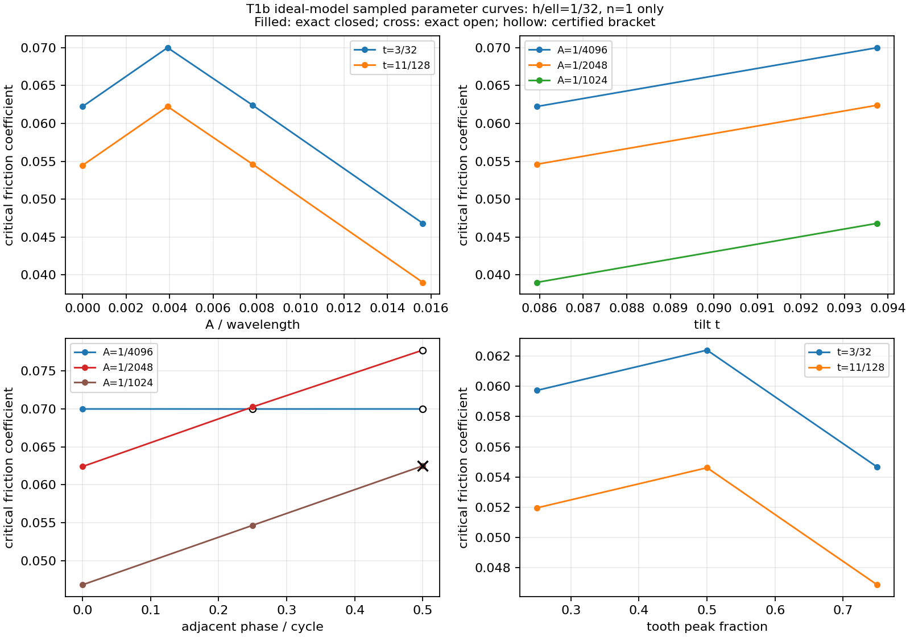

# WO-T1b：TIA 二维制造公差困住与非退化形貌（第二轮复验返修完成）

**一句话结论：A 用独立核验的几何证书判断给定多边形能否仅靠平移逃出；B 是含转动、无限抗压、关联流动的理想刚体极限分析，原36个高宽比1:32的薄块算例虽经独立程序全部复算吻合、齿形也确实改变摩擦阈值，但A=0无齿对照本来就有非零阈值且恰等于T1a细长块公式，主要解释是 T1a 细长块推力线公式的推广，不是新的普适形貌规律，更不能直接套用到厚块、真实材料或有限运动。**

**状态：T1b_DONE。本次m4b同障碍补门已完成：原版绿、对手源码内变异语义红；当前完整快档8853、全档四片14937全部通过，0失败/跳过，静态0违例。§6.4记录本轮实测末行；旧轮记录保留，不冒作当前验证。未commit。**

本报告由 Codex 执行，供 Claude 交接审阅。原轮开工基线 `7f9510502ba265e53b5be8de4be22308dfe65f9a`；工作树 `D:/eab-wt/cx-e2`。原成果最初由未提交工作字节生成，保存了实际源码前后 SHA256；随后 **Claude** 将其保存为本地提交 `e757883ac20fd0b3fa553ce1c3c24a94c1e55c8f`（“T1b 待验收”）。续单入口已核该 HEAD 与干净状态，回滚锚点为其只读 archive，见[入口及来源审计](T1b_evidence/acceptance_fix/intake.json)。Codex 各轮均未执行 Git 写命令；本次入口为Claude保存的773b760，见§6.4。原设计 SHA-256 为 `6d174ecc4f1326d5bac21c56c8d333485fb50bbaef3a12150e94eaff14cb4dac`，设计及 tia2d-2 schema 仍不改；本次新增证据不得倒标成旧基线提交生成。

## 1. 口径、范围与交付导航

- 力学沿用 profile1：刚体、小变形、无限抗压、无黏聚、恒定 μ、关联流动。UNBOUNDED 不是锁定；一阶可动性不是有限运动。
- P0 固定其余块，仅询问一个块的全局平移空间；G5 力控端板在这个几何询问中也固定。腐蚀政策只决定墙/端板是否缩小，其他普通邻块始终腐蚀。
- 单位任意但自洽，所有几何、δ、证书坐标均为有理数。图上小数仅供显示；精确输入不由图或舍入数还原。
- 实测运行时 Python 3.12.10；数值代码纯标准库，只有理想模型的采样参数曲线使用 matplotlib。
- 仅写本工作树及获准的 `D:/eab-evidence/reports/codex/T1b_evidence/`；不写姊妹仓库，不新增静态构造准入，不改既有数学合同。
- 没有生成新的 C++ 正式批次。新增诊断数据**不冒用 tia2d-2 schema**，新公共字段均列在第8节供 Claude 决定。

关键成果：[P0小汇总](T1b_evidence/p0_final_summary.json)、[P0完整输入及证书](file:///D:/eab-evidence/reports/codex/T1b_evidence/p0_final.json)、[P1原始冻结小汇总](T1b_evidence/p1_summary.json)、[P1验收分类及升级](T1b_evidence/acceptance_fix/p1_classification.json)、[理想模型的采样参数曲线](T1b_evidence/acceptance_fix/p1_figures/p1_design_curves.png)、[本轮交付清单](T1b_evidence/acceptance_recheck_m4b/artifacts.md)。原36例完整证书仍保存在[旧批次](file:///D:/eab-evidence/reports/codex/T1b_evidence/p1_final_20261022/)，三项升级证书另存[新批次](file:///D:/eab-evidence/reports/codex/T1b_evidence/acceptance_fix/p1_classification_final/)，未覆盖历史冻结证据。逐文件完整性与外部映射见 [EVIDENCE_ARCHIVE](../EVIDENCE_ARCHIVE.md)。

## 2. A：精确腐蚀、自由空间与独立证书

### 2.1 公差模型与拒收

对简单无洞实心多边形 P，使用闭腐蚀 `Pδ=P⊖δK={x:x+δK⊆P}`。K 分别为 `[-1,1]²` 和顶点 `(±1,±5/12)、(±5/12,±1)` 的有理八边形；后者只是圆形结构元的多边形近似。δ 不经浮点舍入。

`erosion.py` 对凸环精确内移支持半平面；凹环构造边/顶点接触排列，分割所有交点，以先于最近事件的有理左右探针判面，再追踪边界环。它**不是凹环所有原边半平面交**。包含判据还检查结构元严格内部的均值和输入边不得进入其开内部；仅查顶点会在凹槽内产生假包含。

多个环、零面积、孤立点/细线残片、非流形边界均拒收，保留明确理由，不把拒收冒充可逃逸。具名主门为 `test_tia2d_t1b_erosion.py`：独立矩形网格覆盖 oracle、L形与八边形反角闭式、细颈断裂/退化、凹槽反例及确切变换。详见[腐蚀与闭式推导](T1b_evidence/erosion_notes.md)。

### 2.2 判定定义与生产搜索

`Oδ=∪j O(Aiδ,Ajδ)` 为**开贯入集**，`Fδ=R²\Oδ` 保留合法接触边/点。原位0若本来贯入，则没有本单所需自由分量，返回 UNPROVED 及理由。

公差把原接触变成间隙后，这里不再套用原文§3.10的接触锁定措辞；“自由分量是否有界”是本单新增的问题和定义，不能倒写为石根华原文已给出的制造公差定理。

- TRAPPED_TRANSLATION：0所在自由分量有界，且已经通过严格绕数屏障核验。
- ESCAPABLE_TRANSLATION：已经通过有理逃逸折线和末端无限射线核验。
- UNPROVED：输入腐蚀拒收、资源限额或未取得可核验证书；不能读成未困住。

生产 `translation_space.py` 使用原有 `GlobalEntrance2` 的全局开凸片并集。严格相交凸片的中心/交集内点图提出闭曲线；图的基本圈用整数绕数筛选。自由路径先试直线，再用完整边交点排列上的可见图搜索，包括零宽接触缝。**没有把障碍并集换成凸包**。搜索的路径选择/三角剖分序不是公共语义合同。

默认最多512个障碍凸片、2000个排列/可见图顶点；资源限额返回 UNPROVED。这些是搜索资源限额，不是数值阈值；目前限额检查不能为之前的复杂分片构造给出硬墙钟保证。未宣称任意大输入都可在固定时间内完成。

### 2.3 独立核验器的原语与两类证书

`translation_certificates.py` **只导入标准库**，不调用生产 E/O、GlobalEntrance2、生产三角剖分，甚至没有调用允许共用的 `polygons_overlap_exact`。它独立检查简单环并耳切；凸输入保留完整凸片；依据凸片两边族法向作精确 SAT。

1. **逃逸**：从0开始的有理折线，每段闭区间参数 `t∈[0,1]` 与严格投影重叠不等式相交。存在满足所有严格不等式的参数就拒绝；不是只查端点。末端长度平方严格大于原始顶点差 `b−a` 包围盒的对角线平方，还须在该盒外，并返回一条明确的向外坐标轴射线。因此证书确实通向无穷，而非只走了一段很长的路。
2. **困住**：显式首尾重合、关于0绕数非零的有理闭折线。每条线段的两端须满足**同一独立凸片对**全部严格 SAT 不等式，由仿射性证明整段位于该开贯入片内。跨片需要生产显式细分。原位自由；任意通向无穷的自由路径都会改变绕数，必穿越屏障，矛盾。

独立性由 `test_verifier_imports_no_production_geometry` 守护；语义门为 `test_enclosure_has_strict_witnesses`、`test_escape_rejects_a_segment_with_only_free_endpoints`、`test_escape_checks_origin_length_and_explicit_infinite_ray`。完整解释及字段见[核验器说明](T1b_evidence/certificates_notes.md)。

### 2.4 晃动范围：有证书的上下界，不冒称精确分量

返回面积区间与**直径平方区间**。若平方界为 `[a,b]`，直径界严格解释为 `[√a,√b]`，不把平方数当长度。下界来自原点附近半径 r 的整个闭正方形：核验器以 SAT 检查填充方形的所有平移，而非只查四边；它连通到0，故面积至少 `4r²`、直径平方至少 `8r²`。上界来自绕数屏障的包围矩形，边长 dx、dy 给出 `area≤dx·dy`、`diam²≤dx²+dy²`。

这些界可能很宽，尤其δ=0时下界可为0。`test_wobble_checks_the_filled_square_not_only_its_boundary` 防止漏掉方形内部的障碍。手造方形腔的真实分量为 `[-3,3]²`，面积36、直径平方72，已由 `test_large_clearance_remains_trapped_with_certified_wobble_bounds` 夹住。每个 TRAPPED 样点的界及独立核验都在 P0 JSON。

例：稳健燕尾 `wk=5,wn=1,h=4`、方形K、墙也腐蚀、δ=3/8，认证面积 `[9/4,425/8]`、直径平方 `[9/2,1781/16]`。这只报范围，不报不存在的精确面积。

### 2.5 临界公差与单调二分

腐蚀随δ增加使每个实体缩小，因此 Oδ 递减、Fδ 递增；若0已有逃逸路径，后续非退化域内不会重新困住。`critical_tolerance` 只在已认证 T/E 两端之间作二进有理二分，每个返回端点保留完整证书；中途拒收/未证就明确中止，不猜开闭。

独立复核还发现并修复了一个输入消费错误：多次询问若重复消费障碍生成器，第二次可能看到空障碍而签发假逃逸；入口现冻结 moving、obstacles、K。具名回归覆盖三类迭代器。此复核是本次内部开发 QA，**不是 Claude 安排的独立对抗验收**。

## 3. A：燕尾榫、凸耳和逐内块结果

### 3.1 燕尾榫闭式与3×3参数网格

榫头底宽 wk、榫颈上宽 wn、高 h；两侧墙和下墙有限厚，上方开口。令 `m=(wk−wn)/(2h)`、`H=supportK(1,m)`、`c=m+H`，e=1表示边界也腐蚀，e=0表示保留。

移动块最大水平宽度为 `wk−2cδ`；边界上端喉口宽度为 `wn+2ecδ`。从下向上通过须使最宽截面越过喉口，因此瓶颈事件是

**`δ*=(wk−wn)/(2c(1+e))`。**

也可把沿上移 v 的两侧不贯入条件写成 `mv≤(1+e)δH`；移动底部到达墙顶时 `v=h−(1+e)δ`，消去v得到相同事件。等号时整条向上路径允许接触但不贯入，因此δ*本身可逃逸，TRAPPED上端开。

这里限定实际扫描尺寸 `h=2,wall=2`。e=1时事件先于下方接缝可容纳块高（该域内上下水平支撑仍活跃，δ*<h/4）；e=0时下方通道零高度而移动块仍有正面积。个别较大腐蚀量会把移动梯形变三角形，不能无条件使用 h−2δ 作为其实际高度。有限厚侧部仍保留屏障；没有将上述式子推广为任意墙宽/任意形貌的判定器。

方形 `H=1+m`；本扫描0<m<1，八边形 `H=1+5m/12`。每组查δ=0、δ*−ε、δ*、δ*+ε，ε=min(1/1024,δ*/4)，均为 T/T/E/E；另从二进有理端点二分10次并保存两端独立证书。

| wk | wn | 方形，墙保留 | 方形，墙腐蚀 | 八边形，墙保留 | 八边形，墙腐蚀 |
|---:|---:|---:|---:|---:|---:|
| 5/2 | 1 | 3/7 | 3/14 | 24/49 | 12/49 |
| 5/2 | 3/2 | 1/3 | 1/6 | 24/65 | 12/65 |
| 5/2 | 2 | 1/5 | 1/10 | 24/113 | 12/113 |
| 3 | 1 | 1/2 | 1/4 | 24/41 | 12/41 |
| 3 | 3/2 | 3/7 | 3/14 | 24/49 | 12/49 |
| 3 | 2 | 1/3 | 1/6 | 24/65 | 12/65 |
| 7/2 | 1 | 5/9 | 5/18 | 120/181 | 60/181 |
| 7/2 | 3/2 | 1/2 | 1/4 | 24/41 | 12/41 |
| 7/2 | 2 | 3/7 | 3/14 | 24/49 | 12/49 |

表内均为精确δ*，均不取到。

36个政策/参数组合全部通过具名闭式门 `test_tia2d_t1b_tolerance.py`；这不是36个不同物理原型，也不是全参数证明。

### 3.2 拼图式凸耳：只对8条实际弦成立

`tolerance_knob(segments=4,wk=2,wn=1,h=2)` 用有理半角采样并线性截颈：每半圆采样4段，实际鼓包共8弦，再接直颈。结论只对该多边形成立，不对圆或加密极限成立。

最宽点两邻弦为 `x=1−|y−1|/2`，令 `H=supportK(1,1/2)`；腐蚀后最大半宽 `1−Hδ`。保留墙的喉口半宽1/2，故δ*=1/(2H)。墙也腐蚀时，当前活跃上肩 `x=3/2−y/2` 和墙顶 `y=2−δ` 给出喉口半宽 `1/2+(H+1/2)δ`，故δ*=1/(4H+1)。对应事件处满足该弦段分支，底部缝尚不能通过整个块。

| K | 边界政策 | 精确δ*（不取到） | 独立二进有理括号 |
|---|---|---:|---|
| 方形 | 墙保留 | 1/3 | [1365/4096,5467/16384] |
| 方形 | 墙腐蚀 | 1/7 | [1169/8192,2345/16384] |
| 八边形 | 墙保留 | 12/29 | [847/2048,6783/16384] |
| 八边形 | 墙腐蚀 | 6/35 | [2807/16384,1407/8192] |

四项另核δ*±1/16384及δ*，均 T/E/E，因此均不取到。括号本身的 attained=null 与另行证明的 exact_threshold/attained=false 分开存放，不从窄括号猜开闭。

### 3.3 TIA-G1与TIA-G5：空困住集不填“临界值0”

G1 取 Koureas 布置 t=3/32、h=1；G5 取 n=3/5/7、h=1。四种K/边界政策对下列每一内块在δ=0和δ=1/64都得到已独立核验的逃逸路径：

| 布置 | 逐块列举（每一项均 E/E） | δ* |
|---|---|---|
| G1 | block_2、block_3、block_4 | null：δ=0已可逃逸 |
| G5，n=3 | block_1、block_2、block_3 | 同上 |
| G5，n=5 | block_1、block_2、block_3、block_4、block_5 | 同上 |
| G5，n=7 | block_1、block_2、block_3、block_4、block_5、block_6、block_7 | 同上 |

共18内块×4政策=72条目、144次状态查询。部分G1保存的路径来自**排列搜索而非直接射线搜索**，数据区分 `direct_free_path/arrangement_free_path`；这只因为直接搜索先试8个固定方向，不代表几何上必须绕行。G1块2、4分别沿 `(-3/32,1)`、`(3/32,1)`，块3沿 `(0,1)` 即可直线逃出。新增 `test_g1_inner_blocks_have_exact_straight_escape_certificates` 逐块核验δ=0的单段证书；原24个G1政策/公差样点也按这三方向读回核验，见[直射线路径证据](T1b_evidence/acceptance_fix/g1_straight_paths.json)。困住集为空时输出 `empty_trapped_set_already_escapable_at_zero`，不把空集上确界写成0；不借用 LP 的 UNBOUNDED 作判断。

### 3.4 两个具名标准例

- **小正公差敏感**：wk=1025/1024、wn=1、h=2，δ=0困住，δ=1/1024时四政策均逃逸；方形、墙腐蚀的δ*=1/4098。阈值可随头颈差任意小，但不是0。
- **较大公差仍困住**：wk=5、wn=1、h=4、wall=3，δ=3/8时四政策均严格困住。“较大”仅指达到颈宽37.5%，不是任意大δ；退化会拒收。

原“任意正公差立即逃逸”的不可能性订正见第7节；具名门和所有8组政策结果见 P0 小汇总。

## 4. B：含转动的刚体极限分析、采样参数曲线与导数

### 4.1 定义与适用边界

原36构型采用薄块 h=1/16、水平名义间距ℓ=2，即 **h/ℓ=1/32**；这公开改变了细长比，非零基线不能归功于齿形。边界仍是两端 FIXED_BODY，中块在x=0受竖向单位活载，无恒载；参考点与实际LP锚点为 `(5/8,−3/8)`。B允许各自由块平移与转动，是 profile1 的刚体极限分析，与A固定其余块、只允许单块平移的几何问题不同。

四个内部界面 `xk(y)=−5+2k+σk[t(y−h/2)+A fk(y)]`，σ=(-1,-1,1,1)。

- 锯齿：`u=(y/λ+(k−1)φ) mod 1`，`f=u/η`（u≤η）或`(1−u)/(1−η)`。η=1/4、1/2、3/4给非对称/对称两坡度。
- t∈{3/32,11/128}；A∈{1/4096,1/2048,1/1024}另有0控制。
- λ=h/n，n∈{1,2,4}；h固定时实际改变λ，波长不再恒等块高。h/λ仍限制为规定整数周期，并未实现任意截断周期。
- 相邻界面相位增量φ∈{0,1/4,1/2}。
- kinked：`f=max(0,(y/h−η)/(1−η))`，仅两直段，不声称光滑。

所有配合面共享同一组有理顶点，完整轮廓与邻接 CONTACT 均精确核查。36构型是采样参数曲线与交叉补点，**不是五维全笛卡尔网格**。原始定义与结果见[原P1详解](T1b_evidence/p1_report.md)；解释、阈值分类与本次升级以本节和[验收订正说明](T1b_evidence/acceptance_fix/morphology_notes.md)、[分类汇总](T1b_evidence/acceptance_fix/p1_classification.json)为准，旧文与旧数据只作历史来源。

### 4.2 非零基线来自薄块，齿形改变的是已有阈值

两个 **A=0** 控制已是非零，且恰等于 T1a 细长块闭式

`μflat=t−(h/ℓ)(1+t²)`。

在h/ℓ=1/32下，t=3/32得到 **2039/32768**，t=11/128得到 **28551/524288**，均为闭阈。因此“非零”首先来自细长效应，不是齿形创造；本节原36例证明的是齿形改变该基线。真正“无齿零而有齿正”的厚度窄带另列§4.6。

固定 t=3/32、φ=0、η=1/2、n=1：

| A | A/λ | μcrit | 开闭 |
|---|---:|---:|---|
| 0 | 0 | 2039/32768 | 闭 |
| 1/4096 | 1/256 | 9177/131104 | 闭 |
| 1/2048 | 1/128 | 16359/262144 | 闭 |
| 1/1024 | 1/64 | 767/16384 | 闭 |

这些离散点确实随齿幅变化，但所谓“非单调”来自两个承力顶点分支切换，不是发现新的普适形貌规律。A=1/2048的同相对称二周期/四周期阈值分别为319/8188和201/52352。φ=1/2、A=1/1024出现精确**开阈**：t=3/32时1/16，t=11/128时7/128；其控制侧的推力线升高为零，另一侧不必为零，详见§4.3。

36项经本次分类为 **28个精确有理阈值（26闭、2开）+8个无理根认证括号**，后者为6个不可约二次根、2个不可约三次根，仍保持宽度2^-40的有理括号及attained=null。保存下端有界证书和上端无界射线，不把中点当根，也不从无理性猜开闭。全部一阶状态 NONZERO_CONE；所存低端机制均含平移与转动，模式 `associated_translation_rotation` 指这些已保存机制，不声称唯一破坏机制或有限运动存在。

T1a同相G2/G3/G4各重跑一个原族代表，均仍为闭零阈；这与上述T1a**细长平直块**对照是两个不同对照，不应混为“所有T1a都是零”。没有重算或改写整个冻结历史网格。具名门包括 `test_t1b_nondegenerate_shape_and_t1a_zero_control`、`test_t1b_phase_changes_actual_threshold_and_preserves_an_open_endpoint`、`test_t1b_two_point_rule_flat_control_and_branch_switch_window`，以及慢门 `test_t1b_design_curve_cases_have_exact_certificates_and_mobility`。



图：**理想模型的采样参数曲线，h/ℓ=1/32，图中只含n=1**；固定端、关联流动，展示A/λ、t、相位、η。实点为精确闭阈，叉号为精确开阈，空心为无理根认证括号。连线仅连接采样，不宣称中间线性或连续设计定律；近重合不表示精确相等。新PNG已实际打开核验，SVG另作XML解析而未单独光栅核验；数值判断使用JSON。

### 4.3 统一的两点推力线规则及其分支导数

侧块在两个承力顶点间传递共线合力。令所压齿面的有效坡度为s_c、推力线弦的升跨比为q，则相应接触支路满足

**`μ=(s_c−q)/(1+s_c q)`。**

一般实现对弦两端各取相邻可压齿面，用 `abs(cross(N,d))/dot(N,d)` 核方向需求，两端取最大、允许顶点对取最小，再取左右侧较大需求。这是一条解释承力方向的规则，不是替代完整LP的独立几何oracle；仍须原/对偶证书核整体平衡。它准确解释原25个精确阈值和本次升级的3个有理闭阈，合计28例，具名门 `test_t1b_twenty_eight_exact_thresholds_match_two_point_rule`。多周期、非对称、相位所改变的是承力顶点、所压齿面及有效弦，不是这条方向规则本身；不能忽略中块平衡的8例另见§4.5。

对于一周期、同相、对称锯齿的**上半齿面控制分支II**，取H=h/2、s=t−2A/h。控制端点水平/竖直间距为ℓ−sH与H，所以 `q=H/(ℓ−sH)`。代入统一规则消元：

`μII=s−(H/ℓ)(1+s²)`；

`dμ/dt=1−2(H/ℓ)s`，`dμ/dA=−(2/h)[1−2(H/ℓ)s]`。

这只是T1a细长块式的 **t→s、h→h/2** 特例。必须有ℓ−sH>0、正分支，并且该控制端点组对整组装有效、其他齿面不先控制。六个具名点逐点吻合生产精确证书；没有把整个参数域归为此分支，A=1/4096点实际上在另一分支。

小齿幅下的全高弦分支I为 `μI=(t+2A/h−q0)/(1+(t+2A/h)q0)`、`q0=h/(ℓ−th)`。在基准t=3/32、h=1/16、ℓ=2下，两分支一增一减，交点由 `μI(A*)=μII(A*)` 定义；精确二进有理夹逼见分类JSON，显示值为 **A*≈0.00024726634384967746=1.0128029444×(1/4096)**。A=1/4096处到右侧切换点仅约 **3.12571885×10^-6**，该点的正导数只可作这个局部分支附近的导数，不能外推成宽幅值区间规律。

φ=1/2的两个开阈例中，**控制侧**最优推力线升高为零，q=0所以μ=s；并不是左右侧同时零升高。零升高极限不能用有限接触力平衡正竖向荷载，故阈值本身不取到。开阈接触力发散的量级另见§4.7。

基准A=1/2048、t=3/32得到 `μcrit=16359/262144`、`dμ/dA=−2043/64`、`dμ/dt=2043/2048`。生产通过 T1a 的 `implicit_certificate` 合同认证，非阈值差商。共享顶点的A/t jets实际传到切向、法向、接触点及力矩；原始矩阵导数另用精确二次多项式中心差核对。

升级后三个有理点也获得既有阈值导数合同认证：**A方向smooth共26点，t方向smooth共28点**；8个无理括号点的导数仍未证。两个A=0控制的A方向改变骨架，保持null；t方向不改骨架，分别认证509/512、2037/2048。任何导数都不得跨活动证书/骨架切换外推。

### 4.4 原11个括号点：3个有理闭阈与8个无理根

下列编号采用验收脚本的 **zero-based case index**，不是Markdown表格从1计数的行号：

| case index | 精确根 | 取到性 |
|---:|---:|---|
| 13 | 131009/2097408 | 闭 |
| 16 | 98283/2097664 | 闭 |
| 30 | 326839/6291456 | 闭 |

候选必须是临界基多项式的精确零点，且通过基的单侧符号延拓和临界点原始LP精确证书；不是把较窄括号或近似有理拟合冒充认证。工具细分默认从40次改为48次，`critical_parameter`内核及既有合同未改。仅这3项实时重算并另存gzip，派生汇总其余33行沿用冻结证据，不伪称本次数据生成重新计算全部36例；具名测试另实际逐例核验。

其余index 1、2、5、10、11、14为不可约二次根，index 19、22为不可约三次根。二次判别式为非平方；三次分别有模61、模17保次且无根的不可约见证。精确gcd去除明确无关因子后，目标括号内Sturm计数为1；下侧对偶基及上侧承载射线基的每个行列式/分子去除根因子后均无其他根，由端点符号证明单侧证书延拓到同一根。完整整系数多项式、因子阶数、不可约见证及括号保存在[分类证据](T1b_evidence/acceptance_fix/p1_classification.json)，逐项表见[分类说明](T1b_evidence/acceptance_fix/morphology_notes.md)。**无理端点的开闭仍未认证**，正确输出仍是括号与attained=null。

具名门：`test_t1b_three_rational_brackets_upgrade_by_exact_critical_basis`、`test_t1b_eight_irrational_roots_keep_certified_brackets`、`test_t1b_coupled_phase_cubic_has_modular_irreducibility_witness`。

### 4.5 单列效应：左右推力线经中块平衡耦合

8个相位交错例的中块力与力矩平衡耦合左右侧独立最优推力线，完整LP阈值严格高于逐侧两点规则给出的值；这8例恰是上述无理根，而非浮点或括号误差。差值的精确上下界均为正，约在 **1.40434×10^-8～6.35693×10^-4** 范围内。n=4、φ=1/4例高于逐侧推力线值约 **9.73488%**（以推力线值为分母；以完整LP阈值为分母则约8.87%）。因此多数原36例是细长块公式在不同承力顶点上的推广，但不能把所有构型都降为互不耦合的两点公式。数值差及两端推力线均保存在分类JSON；本结论仅覆盖这8个具名输入，不声称任意相位都产生正耦合增量或无理根。

### 4.6 补充厚度窄带：平直为零而加齿后为正

固定t=3/32、ℓ=2、φ=0，令r=h/ℓ、a=A/h；随r改变h和A而保持a、周期数n、非对称度η不变。这不是原图固定h的另一个读法。对四个具名固定族，在解析域 `0<r≤3/16` 中，“平直μcrit=0而加齿μcrit>0”的带为：

| a=A/h | n | η | 精确厚度带r（左闭右开） | 下界处有齿μcrit |
|---:|---:|---:|---|---:|
| 1/64 | 1 | 1/2 | [96/1033,32/257) | 131/8264 |
| 1/128 | 1 | 1/4 | [96/1033,16/145) | 163/12396 |
| 1/256 | 2 | 1/2 | [96/1033,1280/12373) | 4201/528512 |
| 1/256 | 2 | 1/4 | [96/1033,64/677) | 1/708 |

共同下界 `rflat=t/(1+t²)=96/1033≈0.09293`：平直界面在此已取到零阈，而四族有齿阈值仍严格正，故包含下界。右端各族已取到零阈，故不包含上界；第一个上界32/257约0.12451。这精确刻画的是所列固定族，而非把“约0.09～0.125”当通用区间。另用a=1/64、n=2、η=1/2或1/4作负对照，齿形零阈边界分别128/3079、1280/21589，均低于平直边界，因而**没有**这类创造阈值带；不能声称加齿必然更难运动。

**边界推导。** 以z=y/h归一化，界面偏移 `g(z)=t(z−1/2)+a f(z)`。侧块把正水平合力归一为1，其接触力与力矩用 `(q,b)` 表示，`q=Fy/Fx`、`b=z+qg(z)`。μ=0时只有 `s_up=t+an/η`、`s_down=t−an/(1−η)` 两个q值；齿面端点的 `(q,b)` 凸包竖向截宽D(q)在这两个q间是仿射函数。侧块平衡条件为 `rD(q)≥q`，所以临界r在端点取得：

`rtooth=min(s_up/D_up,s_down/D_down)`，

其中 `D_up=[1−(1−η)/n](1+s_up t)+s_up a`，`D_down=(1−η/n)(1+s_down t)−s_down a`。镜像配对供给中块力与力矩平衡；域内两坡度严格正，排除了μ→0时零荷载自应力无界造成的“开零阈”，从而r低于该边界时阈值确为正。六族在0<r≤3/16内还满足 `|hg(z)|<1/32`，不会使间距2的界面交叉或边界体退化，接触拓扑前提明确。这一零摩擦边界是限定六族/区间的全带解析结论；正μ的具体阈值仍逐点用原始LP与单侧基延拓认证，不把边界式扩写成任意参数的μ(r)闭式。完整必要性、充分性与紧致性说明见[厚度带推导](T1b_evidence/acceptance_fix/thickness_notes.md)。

带内几个精确样点如下，各行平直阈值为0、所列有齿阈值均为**闭阈**：

| 固定族(a,n,η) | r | 有齿μcrit |
|---|---:|---:|
| (1/64,1,1/2) | 3/32 | 253/16384 |
| (1/64,1,1/2) | 28864/265481 | 131/16528 |
| (1/128,1,1/4) | 15224/149785 | 163/24792 |
| (1/256,2,1/2) | 1255024/12781309 | 51978973/13078020224 |
| (1/256,2,1/4) | 65552/699341 | 677/958628 |

第一行约0.01544，是“形貌创造阈值”的清楚例子，而不是原薄块非零基线的重复包装。扫描共39个厚度样点，另有6族×r∈{3/16,1/4,1/2}共18个厚块闭零对照。39样点及厚块对照保存40份gzip；[小汇总](T1b_evidence/acceptance_fix/thickness_summary.json)记录每点精确输入、阈值、取到性和SHA，[外部完整证书](file:///D:/eab-evidence/reports/codex/T1b_evidence/acceptance_fix/thickness_final/)不改旧冻结批次。具名门为 `test_t1b_thickness_band_exact_wrench_boundaries`、`test_t1b_thickness_band_flat_zero_teeth_positive_exact_certificates`、`test_t1b_thickness_band_open_upper_and_closed_lower`、`test_t1b_thickness_two_period_large_tooth_has_no_creation_band` 和 `test_t1b_thickness_discrete_thick_controls_remain_closed_zero`；定向结果 `41 passed in 16.80s`。

### 4.7 物理解释的局限与不安全侧

1. **开阈附近所需接触力发散。** 对φ=1/2、A=1/1024、t=3/32、μ*=1/16的开阈例，重跑验收者 `force_blowup.py`，μ*+2^-10、μ*+2^-20、μ*+2^-30时得到约 **656、6.7×10^5、6.9×10^8倍单位荷载** 的法向力尺度。这在无限抗压模型里合法，却不是有限强度材料的可行承载。精确口径脚注：原脚本最小化的是法向力绝对水平分量和U，显示值分别656.19682、672003.58894、688131732.2353；并非直接最小化欧氏总法向力N。本例所有所用面满足|s|≤1/8，故对相应最小值有 `U≤N≤(√65/8)U<1.008U`，上述总法向力量级近似误差界小于0.8%。见[重跑日志](T1b_evidence/acceptance_fix/force_blowup.txt)与[量纲/目标审计](T1b_evidence/acceptance_fix/force_blowup_audit.json)。
2. **微齿在刚体模型中仍完全有效。** 本族A≤h/64也不产生材料压溃、弹性圆钝或接触面积损失；局部有效摩擦角贡献只取决于齿面坡度，所以微小但尖锐的齿面仍能完整生效。但整体阈值还含推力线升跨比q及承力顶点，不能概括为全局结果完全不依赖A。
3. **厚块不能直接套用。** 本次六个固定族分别取h/ℓ∈{3/16,1/4,1/2}，18个离散厚块对照全部为闭零阈；与对手厚度扫描的观察一致。原图h/ℓ=1/32的非零值不是厚块锁定或实际产品性能证据；这18点不证明无限的h/ℓ≥3/16范围，更不是所有厚块和任意齿形的定理。
4. **关联流动的方向。** 此处关联流动阈值是相应非关联库仑阈值的下界，即以所需摩擦衡量属于**不安全侧**；不能将关联流动证书自动当作真实非关联材料的安全验证。

## 5. C：可选项

未执行转动有限路径困住判断，也未做凸耳4/8/16/32加密收敛。按工单不因此记 PARTIAL。所有P0结论均为**平移困住**；所有P1一阶锥均不等于有限SE(2)运动证明，更不宣称转动困住。

## 6. 变异、元门与验证

### 6.1 门的牙与内部修复

| 真实源码内部变异/反例 | 报红的语义门 |
|---|---|
| 困住段允许触及开贯入边界（≤/≥改为</>） | `test_mutation_accepting_nonstrict_enclosure_is_killed`：严格屏障应拒绝接触 |
| 困住段只查两端，允许端点分属**不同障碍**的凸片 | 上一轮跨障碍门 `test_enclosure_rejects_blocked_vertices_with_free_edge_interiors` 与 `test_mutation_checking_trapping_endpoints_in_different_pairs_is_killed`：菱形四顶点分别在四面墙内、边中点自由；不宣称它覆盖同一凹障碍内部的跨片缺陷 |
| 困住段只查两端，允许端点分属**同一凹障碍**的不同凸片对（m4b） | 本轮 `test_enclosure_rejects_blocked_vertices_across_one_concave_obstacle_slit` 与 `test_mutation_checking_trapping_endpoints_in_same_obstacle_pieces_is_killed`：单个C形障碍内的闭路右边穿过开缝；必须拒绝伪困住证书，并核原布置可逃逸 |
| 逃逸段只检查两端 | `test_mutation_checking_only_escape_endpoints_is_killed`：两端自由、中段贯入应拒绝 |
| 障碍并集替换凸包 | `test_mutation_hull_obstruction_is_detected_by_semantic_escape_gate`：已知可绕行的C形出口不能丢失；独立核验仍阻止假困住 |
| 只查结构元顶点而漏凹槽 | U形槽两门、八边形斜角与细颈、八边形刚体运动、凸耳测试；**不是**独立矩形覆盖oracle，详见下文 |
| 连续调用消费生成器变空障碍 | `test_tia2d_t1b_certificates.py` 的迭代器入口回归 |

变异修改运行中的被测函数源码，原语义断言失败；不是产出后塞假数据、哈希不符或解序巧合。元门使用随机有理半角旋转、平移0/10³/10⁵及独立几何/荷载单位缩放；P1还将2^-20特征尺度与10⁵坐标同现。腐蚀变换必须同步旋转K；轴固定方形K本来就不各向同性。

上一轮新增菱形闭环为 `(5/2,0)→(0,5/2)→(−5/2,0)→(0,−5/2)→(5/2,0)`。四顶点分别在不同墙的严格贯入区，四条边中点 `(±5/4,±5/4)` 连同半边长1/4的移动方形都严格位于中央空腔。真实核验器拒绝；运行时从真实 `_witness` 源码注入混片端点变异后，同一语义断言确实报红，独立进程最后一行 `1 failed in 0.09s`。这修复的是测试缺口，生产核验器本来已正确。

顶点式腐蚀变异的定向实际重放为 `11 failed, 6 passed in 1.65s`；矩形覆盖oracle的两个例子都仍绿。真实捕获门是 `test_element_vertex_only_containment_misses_an_indentation`、`test_element_vertices_on_cavity_edges_do_not_certify_filled_containment`、`test_rational_octagon_reflex_bevel_closed_form`（3例）、`test_disconnected_erosion_and_exact_thin_neck_are_rejected[octagon]`、`test_erosion_exact_rigid_motion_and_units`（3个八边形例）和 `test_polygon_knob_reports_actual_segments_and_verified_opposite_states`（2例）。[A订正说明及原始红灯证据](T1b_evidence/acceptance_fix/trapping_fix.md)记录真实报红位置，不把脚手架错误当变异杀伤。

### 6.2 原轮执行证据（历史记录，不覆盖续单新字节）

| 验证 | 实测与边界 |
|---|---|
| 开工全档 | GREEN，14665节点，四分片，0失败/跳过；1437.984s，HEAD只读archive字节导出 |
| 修复前收尾快档 | GREEN，8800节点；66/66模块有实际执行见证，源副本/当时工作字节均未变 |
| 原轮收尾全档（必须保留RED） | 14848节点，14846通过、2失败、0跳过；四片派发/收集/执行多重集合相等；1338.094s |
| 全档覆盖审计 | 原始66/66导入与函数/模块执行见证齐全，但两个失败journal使complete=false，不能报覆盖审计GREEN |
| 全档失败根因 | 两个新测试helper包含不受闭子集支持的assigned lambda/动态函数选择，共13条AST诊断；既有两道仓库门正确报红 |
| 最小修复 | 仅将 `test_tia2d_t1b_morphology.py` 与 `test_tia2d_t1b_tolerance.py` 的helper改为具名函数/显式if；无生产源、工具、schema或fixture修改，无新增准入 |
| 修复后完整快档 | GREEN，8800节点，0失败/跳过；66/66模块执行见证齐全；export_changed/live_tree_changed均空 |
| 修复后两原失败门定向复核 | `2 passed in 409.93s (0:06:49)`；真实全库scan_repository及注释副本均0诊断，并非只扫描两文件 |
| 修复后新增快门+纯度 | `149 passed, 72 deselected in 28.89s`，其中72为按默认规则排除的慢节点，不是skip |
| 修复后无Git字节副本 | PATH中无git且无.git；`111 passed, 72 deselected in 20.98s`；源码前后未变，不是新鲜Git树 |
| P0最终生成与独立回读 | 120算例/政策条目；生成19.432s，整个src+工具前后SHA一致；逐个重核332样点及80括号端点，共412证书（140 T含晃动界、272 E）通过 |
| P1最终生成与独立回读 | 36构型，124.712s，67源文件前后SHA一致；独立标准库回读36 gzip、97份LP证书和全部保存锥生成元通过 |
| 原轮设计/静态准入/字节卫生 | 当轮冻结设计SHA不变、policy原字节不变；历史净增见[原轮交付审计](T1b_evidence/hygiene.json)，本次验收续单另作审计 |

原始完整快档（修复前）最后一行：

```text
8800 passed in 274.03s (0:04:34)
```

原轮helper修复后完整快档最后一行：

```text
8800 passed in 274.81s (0:04:34)
```

原轮RED收尾全档四分片最后一行，按1–4**原样**（不能挑出绿片或拿定向结果拼接）：

```text
1 failed, 3711 passed in 984.12s (0:16:24)
3712 passed in 821.80s (0:13:41)
1 failed, 3711 passed in 1184.75s (0:19:44)
3712 passed in 779.61s (0:12:59)
```

该次CLI静态末行也原样保留：`exact construction AST gate: 13 violation(s)`。修复后两原失败门实际调用全库扫描并断言0，不能把其pytest末行伪装为一次未运行的CLI末行。Codex在原轮未追加完整四分片，遵守当时“一次收尾全档”的成本合同，故当轮如实交付PARTIAL；**这一历史缺口后来由Claude的新鲜树全档补齐**，不再写成尚未发生。新增字节的本次收尾另见§6.3。

证据：[快档](T1b_evidence/final_fast/summary.json)、[全档RED](T1b_evidence/final_full/summary.json)、[定向修复](T1b_evidence/postfix_static.json)、[当轮修复后快档](T1b_evidence/postfix_fast/summary.json)、[无Git](T1b_evidence/no_git_postfix_summary.json)、[P0回读](T1b_evidence/p0_readback.json)、[P1回读](T1b_evidence/p1_readback_audit.json)、[全档后字节差异](T1b_evidence/post_gate_source_check.json)。

### 6.3 第一轮验收续单最终门（历史，773b760复验前）

Claude的本轮验收反馈：其保存的 `e757883` 新鲜工作树已经完成 `--runslow` 四分片 **14848 passed、0 failed、0 skipped**；A/B两名对手均确认数字与证书正确，仅要求补门和订正解释。A对手用自写检查器核对约90万腐蚀网格点0失配、308逃逸及176困住证书全部通过、燕尾/凸耳闭式及阈值处可逃逸吻合，并对18个内块独立找到逃逸路线；B独立LP为36/36吻合。以上是**Claude提供的验收事实**，不是Codex本次重新执行全量独立检查所得；计数范围也不与§6.2原P0回读混算。对手脚本及来源SHA已只读归档，见[入口清单](T1b_evidence/acceptance_fix/intake.json)。

本次A完整证书测试文件定向结果为 `33 passed in 0.16s`，包括新增菱形门、源码内变异门及3个G1直射线参数例；修改文件静态扫描0违例。厚度新增门定向为 `41 passed in 16.80s`。全库预收尾静态CLI已经实际执行，末行 `exact construction AST gate: 0 violation(s)`；不新增准入。

独立标准库落盘回读覆盖36份形貌证书与40份厚度gzip，核验229个LP证书实例（每文件内部去重）；另对11个临界根独立复核Sturm根数、不可约见证及两侧基多项式去根因子后的无额外根条件，全部通过。厚度单独回读核验118份唯一LP证书亦通过。见[统一回读结果](T1b_evidence/acceptance_fix/acceptance_readback.json)、[可复跑回读源码](T1b_evidence/acceptance_fix/acceptance_readback.py.txt)、[厚度回读结果](T1b_evidence/acceptance_fix/thickness_readback.json)。这是对存储的原始矩阵/证书算术独立核验，不冒称又独立推导了所有几何到LP装配。

本次以当前工作树字节为输入，使用原H1四分片运行器的字节导出模式；不是新建Git worktree。运行中导出副本与当前工作树前后哈希均无变化，完整收集、派发、执行节点多重集合相等，快档与全档均0失败/0跳过。模块实际执行审计均为 **66/66**（59函数模块、7声明模块），无缺失导入或执行见证。

| 当前验证 | 结果 |
|---|---|
| 完整快档 | GREEN，8851项，H1总用时301.234s |
| 快慢全档四分片 | GREEN，14935项，H1总用时1430.156s |
| 静态构造 | 0违例，无新增准入 |
| 纯度与冻结合同 | 全套具名门通过；设计/schema/policy/.gitattributes原字节不改 |
| 受测字节 | 两轮运行中export_changed/live_tree_changed均空；收尾仅更新本报告及归档索引，不改变受测代码/测试/工具/夹具 |

当前快档最后一行原样：

```text
8851 passed in 288.75s (0:04:48)
```

当前全档四分片最后一行，按1–4原样：

```text
3734 passed in 910.90s (0:15:10)
3734 passed in 780.31s (0:13:00)
3734 passed in 1288.25s (0:21:28)
3733 passed in 744.79s (0:12:24)
```

当前CLI静态最后一行原样：

```text
exact construction AST gate: 0 violation(s)
```

证据：[完整快档](T1b_evidence/acceptance_fast/summary.json)、[完整全档](T1b_evidence/acceptance_full/summary.json)、[全档实际执行覆盖](T1b_evidence/acceptance_full/module_coverage.json)、[日志和受测源码归档](T1b_evidence/acceptance_fix/gate_archive.json)、[最终代码与受测字节核对](T1b_evidence/acceptance_fix/final_tested_source_audit.json)、[交付卫生/净增量](T1b_evidence/acceptance_fix/hygiene.json)。旧RED不删除、不拼接；本次绿是新名字、独立完整运行。

厚度补充另经内部交叉QA：独立参考LP86次查询、39个持久化样本的阈值及正阈值下侧核对、227个存储矩阵证书实例核验全部通过，见[内部交叉复核](T1b_evidence/acceptance_fix/thickness_cross_review.md)。这不冒称Claude安排的新增独立验收路线，也不替代本次完整门。


### 6.4 第二轮复验：同一凹障碍内跨片的端点式变异

Claude将上一轮返修保存为 `773b760df0e4acd2894f3a4949f0f2953951bfdd`，本次入口已核HEAD及干净状态。其定向复验确认三项有理升级、厚度窄带、推力线解释与措辞均通过独立LP，但m4b骗过此前130项T1b困住测试及静态门；这是所有者给出的复验结论，不冒称本代理又重算了B。原验收脚本只读归档，备份/来源见[本轮入口记录](T1b_evidence/acceptance_recheck_m4b/intake.json)。

反例仅含一个C形凹障碍：外框 `[-3,3]²` 去掉中央 `(-2,2)²`，右壁再开 `x∈[2,3],y∈(-1,1)` 的缝。移动方块为 `[-1/4,1/4]²`，待核闭路是 `(5/2,-5/2)→(5/2,5/2)→(-5/2,5/2)→(-5/2,-5/2)→(5/2,-5/2)`。四角均严格贯入同一障碍，而右边中点 `(5/2,0)` 连同整个移动方块位于开缝中，所以非零绕数与各顶点在O内都不足以证明整条闭路在O内。新门还检查原版生产 `translation_component` 为 `ESCAPABLE_TRANSLATION`，并独立核验其逃逸路径。

本轮变异严格保留“同一个障碍”的限制：对每个障碍的凸片集，分别寻找包含起点和终点的凸片对，再错误放行整段。它与上一轮允许跨障碍的变异是不同缺陷，二者分别有具名语义门；生产核验器原本正确，本轮不改生产代码或冻结证据，也不因本轮补门声称任意可能变异都已覆盖。

本轮定向证书文件最后一行 `35 passed in 0.16s`，修改测试的静态扫描0违例。源码内m4b变异门通过；另在获准外目录的隔离副本中，直接调用对手原版 `make_m4b.py` 注入同一缺陷，以同一个具名语义测试运行独立pytest进程：原版 `1 passed in 0.12s`，变异 `1 failed in 0.20s`。变异直接失败于 `AssertionError: enclosure must reject endpoints in different pieces of one obstacle`，不是源码哈希、构造或环境错误。原版绿灯同时覆盖生产可逃逸状态、人工给定直线及产出路径的独立逃逸核验；66个生产源码文件与测试原件前后哈希一致。

见[独立源码变异审计](T1b_evidence/acceptance_recheck_m4b/m4b_process_audit.json)、[原始语义红灯](T1b_evidence/acceptance_recheck_m4b/m4b_process_audit_mutant.txt)、[可复跑变异脚本](T1b_evidence/acceptance_recheck_m4b/m4b_source_mutation_audit.py.txt)、[原版证书文件全测](T1b_evidence/acceptance_recheck_m4b/m4b_original_tests.txt)。

本轮完整快档及快慢全档使用**当前工作树字节导出**运行，不是新建Git树；两次均核对导出副本和当前工作树前后不变。收集/派发/执行节点多重集合相等，0失败、0跳过，实际执行覆盖66/66（59函数模块、7声明模块）。未改生产代码、冻结数据、设计/schema或静态准入；收尾仅回填本报告、归档索引及独立证据目录。

| 本轮最终验证 | 结果 |
|---|---|
| 完整快档 | GREEN，8853项，H1总用时325.312s |
| 快慢全档四分片 | GREEN，14937项，H1总用时1448.344s |
| 静态构造CLI | 0违例，无新增准入 |
| 字节守卫 | export_changed/live_tree_changed均空；最终代码等于全档受测字节 |

本轮快档最后一行原样：

```text
8853 passed in 312.68s (0:05:12)
```

本轮全档四分片最后一行，按1–4原样：

```text
3735 passed in 952.36s (0:15:52)
3734 passed in 783.71s (0:13:03)
3734 passed in 1302.50s (0:21:42)
3734 passed in 739.98s (0:12:19)
```

本轮静态CLI最后一行原样：

```text
exact construction AST gate: 0 violation(s)
```

证据：[完整快档](T1b_evidence/m4b_fast/summary.json)、[完整四片全档](T1b_evidence/m4b_full/summary.json)、[实际执行覆盖](T1b_evidence/m4b_full/module_coverage.json)、[命令及运行状态](T1b_evidence/acceptance_recheck_m4b/final_gate_runs.json)、[归档映射](T1b_evidence/acceptance_recheck_m4b/gate_archive.json)、[最终受测字节审计](T1b_evidence/acceptance_recheck_m4b/final_tested_source_audit.json)、[净增/卫生](T1b_evidence/acceptance_recheck_m4b/hygiene.json)。旧轮RED与GREEN原样保留；本轮绿色结果来自新名字的两次独立完整运行，不拼接。

## 7. 工单订正清单

1. **δ*=0标准例不可满足原强解释**：若δ=0有严格闭折线屏障，屏障为开O内紧集；有限个严格凸片覆盖具有正裕量，连续小腐蚀后仍成立。因此存在ε>0继续困住。用正但很小的δ*及预设制造公差下逃逸替代；没有改设计合同。
2. **逃逸终点距离标准补强**：仅“很远”不自动证明已到无界分量。核验同时要求在原始差顶点包围盒外，并给明确无限射线；这是更强证书，不是放宽要求。
3. **空困住集**：G1/G5所查内块δ=0已可逃逸，δ*记null/无意义，不填0。
4. **原36例的非零基线须归给细长效应**：采用薄块和左右镜像倾斜族，无齿控制已经恰等于T1a细长块公式；齿形主要改变承力顶点与推力线，不是给原厚块同相族换名称，也不是新普适形貌规律。
5. **原11括号点需分类而非笼统“未证精确根”**：3个已认证为有理闭阈，另8个证明为不可约二次/三次根并保留认证括号；这8根开闭及导数仍未证。开阈2例确实存在，不把所有阈值涂成闭。
6. **搜索路径不等于必须路径**：G1排列搜索产生的三点路径不能用来声称必须绕行，已补单段直射线证书门。
7. **局部斜率与整体幅值效应分开**：微齿的局部有效角贡献只依赖齿面坡度；整体阈值仍取决于推力线q与承力顶点。原“非单调”来自具体分支切换，局部导数不得跨切换推广。

## 8. 建议并入设计的新增清单（未经自动批准）

| 位置 | 候选公共新增 |
|---|---|
| kernel2d/erosion.py | `square_element`、`octagon_element`、`erode_polygon_exact`；`ErosionResult2(status,polygon,reason,rings)` |
| kernel2d/translation_space.py | `translation_component`、`tolerance_component`、`critical_tolerance`；状态串 TRAPPED_TRANSLATION/ESCAPABLE_TRANSLATION/UNPROVED |
| TranslationComponent2 | `status,reason,path,verification,area_bounds,diameter_squared_bounds,inner_square_radius,bounds_verification,source,observable` |
| critical_tolerance诊断结果 | `status,reason,low,high,low_result,high_result,attained`；CERTIFIED_BRACKET与端点证书；无精确事件证明则attained=null |
| kernel2d/translation_certificates.py | `translation_segment_is_free`、`translation_segment_strictly_blocked`、`verify_escape_certificate`、`verify_trapping_certificate`、`verify_wobble_bounds` |
| CertificateVerification | `valid,reason,checked_segments,winding_number,witnesses,ray_direction`；witness索引属于独立分片，不要求复制生产标签序 |
| WobbleBoundsVerification | `valid,reason,area_lower,area_upper,diameter_squared_lower,diameter_squared_upper` |
| adapters/tia2d.py | `tolerance_dovetail`、`tolerance_knob`；后者报告实际弦数和半圆采样数；均为算例适配器，不向内核倒灌域语义 |
| 私有诊断 | P0阈值事件/边界腐蚀标志/实际腐蚀输入；P1阈值/导数/模式/一阶及来源清单。仅工具格式，不修改tia2d-2 |

现有类型/枚举/函数/schema不改；未发现必须违反冻结设计才能完成的事项。静态门中新增模块数由47更新为50，完整导入可达性集合相等断言保留，禁词与白名单未削弱；`exact_construction_policy.json` 原字节不改。

**降为适配器/工具助手，不建议冻结入设计合同：** `g1_morphology`、`MorphologyProfile2`及其 `g1_morphology_seed`。`MorphologyProfile2`中的 `assembly,family,amplitude,wavelength,height,tilt,phase,asymmetry,periods,interfaces,vertex_seeds_amplitude,vertex_seeds_tilt` 只是本次参数扫描与灵敏度传递助手字段，不作为稳定公共schema承诺。临界基分类、推力线解释及厚度带扫描也属工具层研究诊断，不自行升级tia2d-2。

## 9. 可复跑命令、归档与遗留

```powershell
$env:PYTHONIOENCODING='utf-8'
$env:PYTHONDONTWRITEBYTECODE='1'
$env:TEMP='D:/eab-wt/cx-e2/reports/codex/T1b_evidence/tmp'
$env:TMP=$env:TEMP
python -X utf8 tools/tia2d_t1b_run_gates.py --name new_fast
python -X utf8 tools/tia2d_t1b_run_gates.py --name new_full --runslow
python -X utf8 tools/tia2d_t1b_tolerance.py --output D:/eab-evidence/reports/codex/T1b_evidence/p0_new.json --summary reports/codex/T1b_evidence/p0_new_summary.json
python -X utf8 tools/tia2d_t1b_classification.py --source reports/codex/T1b_evidence/p1_summary.json --output D:/eab-evidence/reports/codex/T1b_evidence/acceptance_fix/p1_classification_rerun --summary reports/codex/T1b_evidence/acceptance_fix/p1_classification_rerun.json
python -X utf8 tools/tia2d_t1b_thickness.py --output D:/eab-evidence/reports/codex/T1b_evidence/acceptance_fix/thickness_rerun --summary reports/codex/T1b_evidence/acceptance_fix/thickness_rerun.json --source-revision e757883
```

数据目录必须新建；中断或源码守卫变化整次作废，不能拼接。逐例/逐分片进度落盘；大证据留获准外目录，仓库只留报告、图和小汇总；回滚原字节及清单保留，不自动覆盖用户后续变化。

遗留：资源限额之外输入仍可能UNPROVED；面积/直径只给保守界；8个P1无理端点的开闭与导数未证（根的次数/不可约性及认证括号已给）；任意参数域闭式、真实材料/非关联摩擦、有限转动与圆弧极限均未证明。**Claude对原提交的独立对抗核查与新鲜Git树验证已经执行**；第一轮新增字节已按§6.3验证；本次m4b补门再以§6.4的独立完整运行验证，不冒称由旧绿灯覆盖。C项仍可选，不因未做C记PARTIAL。

## 10. 勘误：δ* 是平移临界公差，不是刚体临界公差（2026-10-25，Claude 在 T2a 验收时追加）

本节为追加，§1～§9 原字节不改写。

§3 各表的 δ* 都是**平移**临界公差，下文记作 δ*_T：δ<δ*_T 时移动块在只允许平移的构形空间中困住。§5 已声明"所有 P0 结论均为平移困住"，但没有给出平移困住与刚体困住的实际差距。WO-T2a 的接触允许 SE(2) 路径证书给出了这一差距：下列 10 个组合在所列区间内平移困住，却可以通过平移加转动的刚体运动逃出。

| 算例 | 形状与参数 | K | 墙政策 | δ*_T（§3） | 平移困住但可刚体逃出的区间 |
|---|---|---|---|---:|---|
| d01 | 燕尾 wk=5/2，wn=3/2 | 方形 | 保留 | 1/3 | [3/10, 1/3) |
| d02 | 燕尾 wk=7/2，wn=3/2 | 方形 | 保留 | 1/2 | [2/5, 1/2) |
| d03 | 燕尾 wk=5/2，wn=1 | 方形 | 保留 | 3/7 | [21/50, 3/7) |
| d04 | 燕尾 wk=5/2，wn=1 | 方形 | 腐蚀 | 3/14 | [1/5, 3/14) |
| d05 | 燕尾 wk=7/2，wn=3/2 | 八边形 | 保留 | 24/41 | [9/20, 24/41) |
| d06 | 燕尾 wk=3，wn=1 | 八边形 | 保留 | 24/41 | [11/20, 24/41) |
| d07 | 燕尾 wk=5/2，wn=3/2 | 八边形 | 保留 | 24/65 | [7/20, 24/65) |
| d08 | 燕尾 wk=3，wn=3/2 | 八边形 | 腐蚀 | 12/49 | [6/25, 12/49) |
| k01 | 凸耳 8 弦 | 方形 | 保留 | 1/3 | [8/25, 1/3) |
| k02 | 凸耳 8 弦 | 八边形 | 保留 | 12/29 | [2/5, 12/29) |

燕尾均为 h=2、wall=2；凸耳为 `tolerance_knob(segments=4)` 的 8 条实际弦，不外推到圆。

**依据。**

1. 每个区间的左端各有一份精确有理 SE(2) 逃逸证书：从精确起始位姿出发，各段满足 |u|≤1、段间按 Cayley 合成精确衔接，每段对每个障碍都不发生内部重叠（允许接触），末段平移射线经 `verify_escape_certificate` 核验。生产核验器与测试侧独立 oracle 逐段一致。证书见 [T2a 证书目录](file:///D:/eab-evidence/reports/codex/T2a_evidence/certificates/)，汇总见 [T2a 报告 §6](T2a_report.md)。所有者在 d60b79b 的新鲜 Git 树上复跑，10 例全部为 VERIFIED_ESCAPE；终版源码复核（`final_reverify_20261025`）结果相同；按定义独立编写的 SE(2) 真值核验器逐段复核 10 例全部成立。
2. 区间内部由腐蚀嵌套性传递，不是逐点扫描。K 为含原点的凸多边形，δ'>δ 时 δK⊆δ'K，所以原位腐蚀满足 B⊖δ'K ⊆ B⊖δK，且两者处在同一坐标系；墙也腐蚀时障碍同样缩小。沿同一条刚体路径，较小块的内部始终落在较大块的内部之中，因此不贯入与末段射线都保持成立。这一步只用到集合包含，不要求中间各 δ 的腐蚀结果另有形状性质。燕尾是凸梯形，腐蚀后仍为凸多边形；§3.1 在 δ*_T−ε 处的样点已被接受，所以整个区间上腐蚀结果都是非退化的。δ≥δ*_T 时块本来就可平移逃出。
3. 这些区间只说明刚体临界公差 δ*_SE2 不大于区间左端。δ*_SE2 本身没有确定，可能更小。

**修正后的读法。**

- §3 各表与相关文字中的"困住""TRAPPED"一律读作"平移困住"。δ*_T 不得当作刚体锁住或互锁的公差界。
- 本节未列出的其余组合，包括 §3.4 的"较大公差仍困住"例，本次没有做转动检查。它们既不能读成刚体困住，也不能读成可刚体逃出。刚体困住须由 T2b 的笼证书另行证明。
- SE(2) 首次贯入判定来自本仓库 M5a 与 WO-T2a，不是石根华原文的结论。

T1b_DONE
